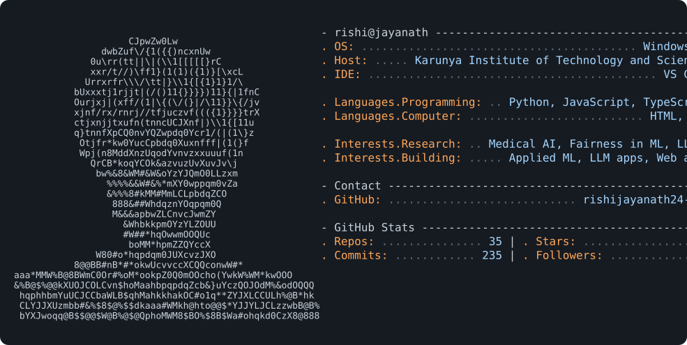

<picture>
  <source media="(prefers-color-scheme: dark)" srcset="assets/card-dark.svg">
  <source media="(prefers-color-scheme: light)" srcset="assets/card-light.svg">
  
</picture>

I am a computer science student at Karunya Institute of Technology and Sciences. I work on applied machine learning, LLM applications, and web apps.

My research interests are medical AI, explainable vision models, fairness-aware machine learning, and retrieval-augmented generation.

## Selected work

**[adni_project](https://github.com/rishijayanath24-cpu/adni_project)**: Fairness- and horizon-audited sequential modality acquisition for Alzheimer's risk stratification, using real ADNI data (1,622 MCI-at-baseline subjects). The main result is that no published acquisition policy beats a fixed or random rule, and that MRI-only input at cost 1.0 is not significantly worse than acquiring all four modalities at cost 9.5. Python.

**[fungi](https://github.com/rishijayanath24-cpu/fungi)**: Adaptive Confidence-Guided Multi-Scale Fusion (ACMF) for microscopic fungal species classification on the DeFungi dataset. It weights the predictions of 224px and 384px ViT-B/16 models by per-image prediction entropy. Written up as an IEEE conference submission. Python.

**[Radix-TMH](https://github.com/rishijayanath24-cpu/Radix-TMH)**: Hackathon project that tells a candidate how ready they are for a specific job. It covers JD analysis, resume parsing, profile building, and matching against a company's bar or a single JD. React, FastAPI, Supabase.

**[ecommerce-gpt-chatbot](https://github.com/rishijayanath24-cpu/ecommerce-gpt-chatbot)**: Retrieval-augmented chatbot running on a local LLM through Ollama. An LLM-based intent detector routes each query to FAQ search, product recommendation, product QA, or review sentiment. Jupyter, Sentence Transformers, Hugging Face.

**[gpt4_exp4](https://github.com/rishijayanath24-cpu/gpt4_exp4)**: Console app that builds a learner profile, matches it against a catalog with Sentence Transformers, and has an LLM rank and explain recommendations, refining them from plain-English feedback. Python.

The rest are on my [repositories tab](https://github.com/rishijayanath24-cpu?tab=repositories).

## Recently active

Updated daily from the GitHub API.

<!-- recent:start -->
| Repository | Language | Last push |
|---|---|---|
| [adni_project](https://github.com/rishijayanath24-cpu/adni_project) | Python | 10 days ago |
| [gpt4_exp4](https://github.com/rishijayanath24-cpu/gpt4_exp4) | Python | 10 days ago |
| [FLUTTER_10](https://github.com/rishijayanath24-cpu/FLUTTER_10) | - | 24 days ago |
| [flutter_exp9](https://github.com/rishijayanath24-cpu/flutter_exp9) | - | 24 days ago |
| [ADNI](https://github.com/rishijayanath24-cpu/ADNI) | Python | 29 days ago |
<!-- recent:end -->

## Tools

- Languages: Python, JavaScript, TypeScript, HTML, CSS
- ML: PyTorch, Hugging Face, scikit-learn, pandas, Jupyter, Ollama
- Web and tooling: React, Vite, FastAPI, Django, Supabase, Flutter, Docker, GitHub Actions, Git
